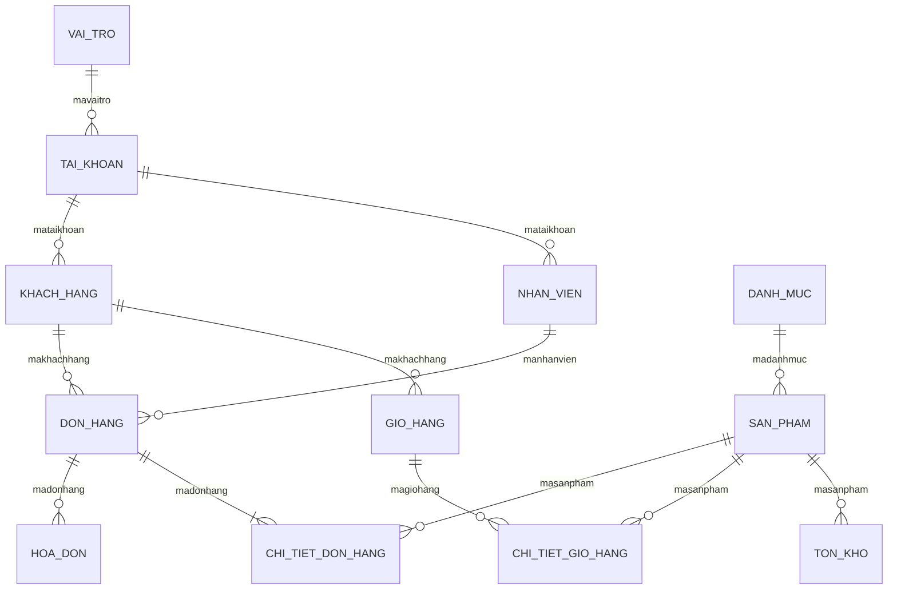

# MỤC II.1 – THIẾT KẾ VÀ CÀI ĐẶT CƠ SỞ DỮ LIỆU (BÁO CÁO WORD - THÀNH VIÊN 2)

---

## 2.1. Sơ đồ quan hệ giữa các bảng (ERD - 13 Bảng dữ liệu)

Hệ thống **Quản lý Cửa hàng Điện thoại iPhone** sử dụng hệ quản trị CSDL **PostgreSQL** kết hợp **Prisma ORM**, gồm **13 bảng dữ liệu** liên kết chặt chẽ theo đúng sơ đồ quan hệ của nhóm:

1. **`VAI_TRO`**: Quản lý danh mục vai trò người dùng (`ADMIN`, `NHAN_VIEN`, `KHACH_HANG`).
2. **`TAI_KHOAN`**: Quản lý thông tin tài khoản đăng nhập hệ thống.
3. **`NHAN_VIEN`**: Lưu thông tin hồ sơ nhân viên bán hàng.
4. **`KHACH_HANG`**: Lưu thông tin hồ sơ khách hàng mua sắm.
5. **`DANH_MUC`** *(TV2 phụ trách)*: Quản lý danh mục các dòng sản phẩm iPhone (`iPhone 16 Series`, `iPhone 15 Series`,...).
6. **`SAN_PHAM`** *(TV2 phụ trách)*: Quản lý chi tiết từng phiên bản sản phẩm iPhone theo dung lượng (`dungluong`), màu sắc (`mausac`), giá bán (`giaban`), hình ảnh (`hinhanh`) và trạng thái kinh doanh (`trangthai` — hỗ trợ **Soft Delete**).
7. **`TON_KHO`** *(TV2 phụ trách)*: Quản lý số lượng tồn kho và thời điểm cập nhật tồn kho của từng sản phẩm.
8. **`GIO_HANG`**: Quản lý giỏ hàng của từng khách hàng.
9. **`CHI_TIET_GIO_HANG`**: Lưu danh sách các sản phẩm khách hàng đã chọn vào giỏ.
10. **`DON_HANG`**: Quản lý thông tin đơn đặt hàng và trạng thái duyệt đơn.
11. **`CHI_TIET_DON_HANG`**: Lưu chi tiết từng sản phẩm, số lượng, đơn giá và thành tiền trong mỗi đơn hàng.
12. **`HOA_DON`**: Quản lý hóa đơn thanh toán gắn với đơn hàng.
13. **`BAO_CAO_DOANH_THU`**: Lưu trữ lịch sử tổng hợp báo cáo thống kê doanh thu theo kỳ.

---

## 2.2. Bảng Từ điển Dữ liệu (Data Dictionary) Chi tiết cho 13 Bảng

### 1. Bảng `VAI_TRO` (Vai trò người dùng)
| STT | Tên thuộc tính | Kiểu dữ liệu | Ràng buộc (Constraints) | Mô tả ý nghĩa |
|:---:|:---|:---|:---|:---|
| 1 | `mavaitro` | `SERIAL (INT)` | `PRIMARY KEY`, `NOT NULL` | Mã định danh vai trò tự tăng |
| 2 | `tenvaitro` | `VARCHAR(100)` | `UNIQUE`, `NOT NULL`, `CHECK (length > 0)` | Tên vai trò (`ADMIN`, `NHAN_VIEN`, `KHACH_HANG`) |
| 3 | `mota` | `TEXT` | `NULL` | Mô tả quyền hạn của vai trò |

### 2. Bảng `TAI_KHOAN` (Tài khoản đăng nhập)
| STT | Tên thuộc tính | Kiểu dữ liệu | Ràng buộc (Constraints) | Mô tả ý nghĩa |
|:---:|:---|:---|:---|:---|
| 1 | `mataikhoan` | `SERIAL (INT)` | `PRIMARY KEY`, `NOT NULL` | Mã tài khoản tự tăng |
| 2 | `tendangnhap` | `VARCHAR(100)` | `UNIQUE`, `NOT NULL` | Tên đăng nhập duy nhất |
| 3 | `matkhau` | `VARCHAR(255)` | `NOT NULL` | Mật khẩu đã mã hóa Bcrypt |
| 4 | `email` | `VARCHAR(255)` | `UNIQUE`, `NOT NULL`, `CHECK (Email format)` | Địa chỉ email đăng ký |
| 5 | `trangthai` | `VARCHAR(30)` | `NOT NULL`, `DEFAULT 'HOAT_DONG'`, `CHECK IN ('HOAT_DONG','KHOA')` | Trạng thái tài khoản |
| 6 | `mavaitro` | `INTEGER` | `FOREIGN KEY` -> `VAI_TRO(mavaitro)` (`ON DELETE RESTRICT`) | Mã vai trò của tài khoản |

### 3. Bảng `NHAN_VIEN` (Nhân viên bán hàng)
| STT | Tên thuộc tính | Kiểu dữ liệu | Ràng buộc (Constraints) | Mô tả ý nghĩa |
|:---:|:---|:---|:---|:---|
| 1 | `manhanvien` | `SERIAL (INT)` | `PRIMARY KEY`, `NOT NULL` | Mã nhân viên tự tăng |
| 2 | `hoten` | `VARCHAR(150)` | `NOT NULL` | Họ và tên nhân viên |
| 3 | `sdt` | `VARCHAR(20)` | `UNIQUE`, `CHECK (SDT hợp lệ)` | Số điện thoại nhân viên |
| 4 | `diachi` | `TEXT` | `NULL` | Địa chỉ liên hệ |
| 5 | `chucvu` | `VARCHAR(100)` | `NULL` | Chức vụ công tác |
| 6 | `ngayvaolam` | `TIMESTAMP(3)` | `DEFAULT CURRENT_TIMESTAMP` | Ngày vào làm việc |
| 7 | `mataikhoan` | `INTEGER` | `FOREIGN KEY`, `UNIQUE` -> `TAI_KHOAN(mataikhoan)` | Mã tài khoản liên kết |

### 4. Bảng `KHACH_HANG` (Khách hàng)
| STT | Tên thuộc tính | Kiểu dữ liệu | Ràng buộc (Constraints) | Mô tả ý nghĩa |
|:---:|:---|:---|:---|:---|
| 1 | `makhachhang` | `SERIAL (INT)` | `PRIMARY KEY`, `NOT NULL` | Mã khách hàng tự tăng |
| 2 | `hoten` | `VARCHAR(150)` | `NOT NULL` | Họ và tên khách hàng |
| 3 | `sdt` | `VARCHAR(20)` | `CHECK (SDT hợp lệ)` | Số điện thoại nhận hàng |
| 4 | `diachi` | `TEXT` | `NULL` | Địa chỉ giao hàng |
| 5 | `mataikhoan` | `INTEGER` | `FOREIGN KEY`, `UNIQUE` -> `TAI_KHOAN(mataikhoan)` | Mã tài khoản liên kết |

### 5. Bảng `DANH_MUC` (Danh mục dòng iPhone – TV2)
| STT | Tên thuộc tính | Kiểu dữ liệu | Ràng buộc (Constraints) | Mô tả ý nghĩa |
|:---:|:---|:---|:---|:---|
| 1 | `madanhmuc` | `SERIAL (INT)` | `PRIMARY KEY`, `NOT NULL` | Mã danh mục dòng iPhone |
| 2 | `tendanhmuc` | `VARCHAR(150)` | `UNIQUE`, `NOT NULL`, `CHECK (length > 0)` | Tên dòng iPhone (`iPhone 16 Series`, `iPhone 15 Series`,...) |
| 3 | `mota` | `TEXT` | `NULL` | Mô tả chi tiết danh mục |

### 6. Bảng `SAN_PHAM` (Sản phẩm & Phiên bản iPhone – TV2)
| STT | Tên thuộc tính | Kiểu dữ liệu | Ràng buộc (Constraints) | Mô tả ý nghĩa |
|:---:|:---|:---|:---|:---|
| 1 | `masanpham` | `SERIAL (INT)` | `PRIMARY KEY`, `NOT NULL` | Mã định danh sản phẩm tự tăng |
| 2 | `tensanpham` | `VARCHAR(200)` | `NOT NULL`, `UNIQUE(tensanpham, dungluong, mausac)` | Tên dòng máy iPhone (`iPhone 16 Pro Max`) |
| 3 | `dungluong` | `VARCHAR(30)` | `NOT NULL`, `CHECK IN ('64GB','128GB','256GB','512GB','1TB','2TB')` | Dung lượng bộ nhớ của phiên bản |
| 4 | `mausac` | `VARCHAR(50)` | `NOT NULL`, `UNIQUE(tensanpham, dungluong, mausac)` | Màu sắc phiên bản (`Titan Sa Mạc`, `Titan Tự Nhiên`,...) |
| 5 | `giaban` | `DECIMAL(15,2)` | `NOT NULL`, `CHECK (giaban > 0)` | Giá bán niêm yết (VNĐ) |
| 6 | `mota` | `TEXT` | `NULL` | Mô tả chi tiết & mã SKU định danh phiên bản |
| 7 | `hinhanh` | `VARCHAR(500)` | `NULL` | Đường dẫn hình ảnh sản phẩm |
| 8 | `trangthai` | `VARCHAR(30)` | `NOT NULL`, `DEFAULT 'DANG_BAN'`, `CHECK IN ('DANG_BAN','NGUNG_KINH_DOANH','HET_HANG')` | Trạng thái kinh doanh (`NGUNG_KINH_DOANH` = Soft Delete / Ẩn sản phẩm) |
| 9 | `madanhmuc` | `INTEGER` | `FOREIGN KEY` -> `DANH_MUC(madanhmuc)` (`ON DELETE RESTRICT`) | Mã danh mục dòng iPhone (Chặn xóa danh mục đang có sản phẩm) |

### 7. Bảng `TON_KHO` (Quản lý tồn kho – TV2)
| STT | Tên thuộc tính | Kiểu dữ liệu | Ràng buộc (Constraints) | Mô tả ý nghĩa |
|:---:|:---|:---|:---|:---|
| 1 | `matonkho` | `SERIAL (INT)` | `PRIMARY KEY`, `NOT NULL` | Mã bản ghi tồn kho tự tăng |
| 2 | `masanpham` | `INTEGER` | `FOREIGN KEY` -> `SAN_PHAM(masanpham)` (`ON DELETE RESTRICT`) | Mã sản phẩm được quản lý tồn kho |
| 3 | `soluong` | `INTEGER` | `NOT NULL`, `DEFAULT 0`, `CHECK (soluong >= 0)` | Số lượng máy tồn kho hiện có |
| 4 | `ngaycapnhat` | `TIMESTAMP(3)` | `NOT NULL`, `DEFAULT CURRENT_TIMESTAMP` | Thời điểm cập nhật số lượng tồn kho |

### 8. Bảng `GIO_HANG` (Giỏ hàng)
| STT | Tên thuộc tính | Kiểu dữ liệu | Ràng buộc (Constraints) | Mô tả ý nghĩa |
|:---:|:---|:---|:---|:---|
| 1 | `magiohang` | `SERIAL (INT)` | `PRIMARY KEY`, `NOT NULL` | Mã giỏ hàng tự tăng |
| 2 | `makhachhang` | `INTEGER` | `FOREIGN KEY` -> `KHACH_HANG(makhachhang)` (`ON DELETE CASCADE`) | Mã khách hàng sở hữu giỏ hàng |

### 9. Bảng `CHI_TIET_GIO_HANG` (Chi tiết giỏ hàng)
| STT | Tên thuộc tính | Kiểu dữ liệu | Ràng buộc (Constraints) | Mô tả ý nghĩa |
|:---:|:---|:---|:---|:---|
| 1 | `machitietgio` | `SERIAL (INT)` | `PRIMARY KEY`, `NOT NULL` | Mã chi tiết giỏ hàng |
| 2 | `magiohang` | `INTEGER` | `FOREIGN KEY` -> `GIO_HANG(magiohang)` (`ON DELETE CASCADE`) | Mã giỏ hàng |
| 3 | `masanpham` | `INTEGER` | `FOREIGN KEY` -> `SAN_PHAM(masanpham)` (`ON DELETE RESTRICT`) | Mã sản phẩm trong giỏ |
| 4 | `soluong` | `INTEGER` | `NOT NULL`, `CHECK (soluong > 0)` | Số lượng sản phẩm chọn mua |
| 5 | `dongia` | `DECIMAL(15,2)` | `NOT NULL`, `CHECK (dongia > 0)` | Đơn giá sản phẩm |

### 10. Bảng `DON_HANG` (Đơn đặt hàng)
| STT | Tên thuộc tính | Kiểu dữ liệu | Ràng buộc (Constraints) | Mô tả ý nghĩa |
|:---:|:---|:---|:---|:---|
| 1 | `madonhang` | `SERIAL (INT)` | `PRIMARY KEY`, `NOT NULL` | Mã đơn hàng tự tăng |
| 2 | `makhachhang` | `INTEGER` | `FOREIGN KEY` -> `KHACH_HANG(makhachhang)` (`ON DELETE RESTRICT`) | Khách hàng đặt đơn |
| 3 | `manhanvien` | `INTEGER` | `FOREIGN KEY` -> `NHAN_VIEN(manhanvien)` (`ON DELETE SET NULL`), `NULL` | Nhân viên duyệt/xác nhận đơn |
| 4 | `ngaydat` | `TIMESTAMP(3)` | `NOT NULL`, `DEFAULT CURRENT_TIMESTAMP` | Ngày giờ đặt hàng |
| 5 | `ngayxacnhan` | `TIMESTAMP(3)` | `NULL` | Ngày giờ nhân viên xác nhận đơn |
| 6 | `tongtien` | `DECIMAL(15,2)` | `NOT NULL`, `CHECK (tongtien >= 0)` | Tổng giá trị đơn hàng (VNĐ) |
| 7 | `phuongthucthanhtoan` | `VARCHAR(50)` | `NOT NULL`, `DEFAULT 'COD'` | Phương thức thanh toán (`COD`, `CHUYEN_KHOAN`) |
| 8 | `trangthai` | `VARCHAR(30)` | `NOT NULL`, `DEFAULT 'CHO_XAC_NHAN'`, `CHECK IN ('CHO_XAC_NHAN','DA_XAC_NHAN','DANG_GIAO','HOAN_THANH','DA_HUY')` | Trạng thái xử lý đơn hàng |

### 11. Bảng `CHI_TIET_DON_HANG` (Chi tiết đơn hàng)
| STT | Tên thuộc tính | Kiểu dữ liệu | Ràng buộc (Constraints) | Mô tả ý nghĩa |
|:---:|:---|:---|:---|:---|
| 1 | `machitiet` | `SERIAL (INT)` | `PRIMARY KEY`, `NOT NULL` | Mã chi tiết đơn hàng |
| 2 | `madonhang` | `INTEGER` | `FOREIGN KEY` -> `DON_HANG(madonhang)` (`ON DELETE CASCADE`) | Mã đơn hàng |
| 3 | `masanpham` | `INTEGER` | `FOREIGN KEY` -> `SAN_PHAM(masanpham)` (`ON DELETE RESTRICT`) | Mã sản phẩm (Chặn xóa vật lý sản phẩm đã có đơn hàng) |
| 4 | `soluong` | `INTEGER` | `NOT NULL`, `CHECK (soluong > 0)` | Số lượng mua |
| 5 | `dongia` | `DECIMAL(15,2)` | `NOT NULL`, `CHECK (dongia > 0)` | Đơn giá cố định tại thời điểm mua |
| 6 | `thanhtien` | `DECIMAL(15,2)` | `NOT NULL`, `CHECK (thanhtien = soluong * dongia)` | Thành tiền (`soluong * dongia`) |

### 12. Bảng `HOA_DON` (Hóa đơn bán hàng)
| STT | Tên thuộc tính | Kiểu dữ liệu | Ràng buộc (Constraints) | Mô tả ý nghĩa |
|:---:|:---|:---|:---|:---|
| 1 | `mahoadon` | `SERIAL (INT)` | `PRIMARY KEY`, `NOT NULL` | Mã hóa đơn tự tăng |
| 2 | `madonhang` | `INTEGER` | `FOREIGN KEY`, `UNIQUE` -> `DON_HANG(madonhang)` (`ON DELETE RESTRICT`) | Mã đơn hàng xuất hóa đơn |
| 3 | `ngaylap` | `TIMESTAMP(3)` | `NOT NULL`, `DEFAULT CURRENT_TIMESTAMP` | Ngày giờ lập hóa đơn |
| 4 | `tongtien` | `DECIMAL(15,2)` | `NOT NULL`, `CHECK (tongtien >= 0)` | Tổng tiền thanh toán trên hóa đơn |
| 5 | `hinhthuctt` | `VARCHAR(50)` | `NOT NULL` | Hình thức thanh toán |

### 13. Bảng `BAO_CAO_DOANH_THU` (Báo cáo thống kê doanh thu)
| STT | Tên thuộc tính | Kiểu dữ liệu | Ràng buộc (Constraints) | Mô tả ý nghĩa |
|:---:|:---|:---|:---|:---|
| 1 | `mabaocao` | `SERIAL (INT)` | `PRIMARY KEY`, `NOT NULL` | Mã báo cáo doanh thu |
| 2 | `ngaybatdau` | `TIMESTAMP(3)` | `NOT NULL` | Ngày bắt đầu kỳ báo cáo |
| 3 | `ngayketthuc` | `TIMESTAMP(3)` | `NOT NULL`, `CHECK (ngayketthuc >= ngaybatdau)` | Ngày kết thúc kỳ báo cáo |
| 4 | `tongdoanhthu` | `DECIMAL(15,2)` | `NOT NULL`, `DEFAULT 0`, `CHECK (tongdoanhthu >= 0)` | Tổng doanh thu trong kỳ |
| 5 | `tongsodonhang` | `INTEGER` | `NOT NULL`, `DEFAULT 0`, `CHECK (tongsodonhang >= 0)` | Tổng số đơn hàng trong kỳ |
| 6 | `soluongsanphamdaban` | `INTEGER` | `NOT NULL`, `DEFAULT 0`, `CHECK (soluongsanphamdaban >= 0)` | Tổng số lượng sản phẩm đã bán |
