# MỤC A.3 – GIAO DIỆN KHÁCH HÀNG VÀ QUY TRÌNH MUA SẮM (STOREFRONT)
## BÁO CÁO CHI TIẾT ĐỒ ÁN MÔN HỌC: PHÂN TÍCH THIẾT KẾ HỆ THỐNG THÔNG TIN
- **Hệ thống thương mại:** iStore – Hệ thống phân phối iPhone
- **Phạm vi lựa chọn theo Barem Giảng viên:** Căn cứ mục **III. Lưu ý** trong file đề bài (`2026_2027_HK1 - DO AN PTTK HTTT.docx`), nhóm thống nhất chọn **MỤC A – MUA HÀNG** (không thực hiện mục B - Nhập xuất kho).
- **Phân công trách nhiệm:** **Thành viên 3** phụ trách trọn gói **Mục A3 – Người mua hàng (20 điểm Phần mềm + Phối hợp Báo cáo)**.

---

## 1. GIỚI THIỆU PHÂN HỆ VÀ PHẠM VI NGHIỆP VỤ

Phân hệ **Giao diện Khách hàng và Quy trình Mua sắm (Storefront)** của hệ thống **iStore** đóng vai trò là điểm tiếp xúc trực tiếp giữa khách hàng và cửa hàng bán lẻ iPhone. Toàn bộ trải nghiệm của người mua hàng từ giai đoạn tiếp cận sản phẩm, tìm kiếm tức thì (Live Autocomplete Search), lựa chọn cấu hình máy (dung lượng, màu sắc), quản lý giỏ hàng đến việc hoàn tất thủ tục đặt hàng trực tuyến đều được xây dựng trên nền tảng công nghệ hiện đại **Next.js 14 (App Router)** kết hợp thư viện quản lý trạng thái **Zustand** và cơ chế đồng bộ tức thời với cơ sở dữ liệu **PostgreSQL** thông qua **NestJS RESTful API**.

Tất cả tài nguyên hình ảnh sản phẩm được lưu trữ cục bộ tại thư mục `frontend/public/images/products/` theo tiêu chuẩn studio chính hãng của Apple, bảo đảm tính thẩm mỹ đồng bộ, tốc độ tải nhanh và dễ dàng tùy biến mở rộng.

### Mục tiêu kỹ thuật và nghiệp vụ:
1. **Trải nghiệm mượt mà, chuẩn mực thương mại điện tử:** Thiết kế giao diện theo ngôn ngữ tối giản, sang trọng của Apple Store (iStore), sử dụng hệ thống icon vector chuẩn công nghiệp (Lucide Icons), tối ưu hóa trên mọi kích thước màn hình (Responsive Design).
2. **Tìm kiếm tức thì (Live Autocomplete Search):** Khách hàng gõ từng ký tự đến đâu, hệ thống lập tức hiển thị popover gợi ý các sản phẩm phù hợp đến đó kèm hình ảnh, màu sắc, dung lượng và giá bán.
3. **Kiểm soát tồn kho chặt chẽ (Anti-Overselling):** Ngăn chặn khách hàng thêm vào giỏ hoặc đặt mua vượt quá số lượng máy thực tế có trong kho (`TON_KHO.soluong`) ngay từ phía giao diện người dùng.
4. **Đối chiếu dữ liệu tức thời tại thời điểm Checkout:** Tự động gọi API để kiểm tra lại giá bán và tình trạng kinh doanh của toàn bộ sản phẩm trong giỏ hàng ngay khi khách hàng mở trang thanh toán. Kịp thời cảnh báo khi có sự thay đổi giá, hết hàng hoặc sản phẩm bị ngừng kinh doanh (Soft Delete).
5. **Bảo mật và an toàn dữ liệu:** Bắt buộc khách hàng xác thực danh tính (đăng nhập) trước khi tạo đơn hàng. Server NestJS (TV4) tiếp tục xác thực lại toàn bộ dữ liệu (không tin tưởng giá gửi từ client) và ghi nhận đơn hàng ở trạng thái `CHO_XAC_NHAN`.

---

## 2. SƠ ĐỒ PHÂN RÃ CHỨC NĂNG (BFD - BUSINESS FUNCTION DIAGRAM)

Sơ đồ phân rã chức năng mô tả cấu trúc phân cấp toàn bộ các chức năng thuộc phạm vi phụ trách của **Người mua hàng (Mục A3)**:

```mermaid
graph TD
    A["HỆ THỐNG QUẢN LÝ BÁN HÀNG IPHONE"] --> B["3.0 PHÂN HỆ NGƯỜI MUA HÀNG (STOREFRONT)"]
    
    B --> B1["3.1 DUYỆT & TÌM KIẾM SẢN PHẨM"]
    B --> B2["3.2 XEM CHI TIẾT & BIẾN THỂ"]
    B --> B3["3.3 QUẢN LÝ GIỎ HÀNG"]
    B --> B4["3.4 QUY TRÌNH ĐẶT HÀNG (CHECKOUT)"]

    B1 --> B11["3.1.1 Xem Banner & Dòng iPhone Trang Chủ"]
    B1 --> B12["3.1.2 Tìm kiếm theo Tên máy, SKU, Màu sắc"]
    B1 --> B13["3.1.3 Lọc theo Dòng máy (iPhone 16, 15, 14, 13)"]
    B1 --> B14["3.1.4 Lọc theo Dung lượng (128GB, 256GB, 512GB, 1TB)"]
    B1 --> B15["3.1.5 Lọc theo Khoảng giá bán"]
    B1 --> B16["3.1.6 Sắp xếp theo Giá tăng/giảm, Mới nhất"]

    B2 --> B21["3.2.1 Xem Thư viện Hình ảnh & Thông số kỹ thuật"]
    B2 --> B22["3.2.2 Chuyển đổi qua lại giữa các phiên bản Màu & Dung lượng"]
    B2 --> B23["3.2.3 Xem Tồn kho thực tế (Còn hàng, Sắp hết, Hết hàng)"]
    B2 --> B24["3.2.4 Xem Sản phẩm liên quan cùng phân khúc"]

    B3 --> B31["3.3.1 Thêm sản phẩm vào Giỏ (Chặn vượt tồn kho)"]
    B3 --> B32["3.3.2 Tăng / Giảm số lượng máy mua"]
    B3 --> B33["3.3.3 Xóa từng món hoặc Xóa toàn bộ giỏ hàng"]
    B3 --> B34["3.3.4 Tự động lưu trữ giỏ hàng vào LocalStorage"]
    B3 --> B35["3.3.5 Tính Tạm tính, Phí vận chuyển và Tổng thanh toán"]

    B4 --> B41["3.4.1 Kiểm tra & Yêu cầu Đăng nhập Khách hàng"]
    B4 --> B42["3.4.2 Đối chiếu Giá bán & Tồn kho mới nhất từ API"]
    B4 --> B43["3.4.3 Cảnh báo Sản phẩm Đổi giá, Hết hàng hoặc Ngừng bán"]
    B4 --> B44["3.4.4 Nhập Thông tin người nhận & Địa chỉ giao hàng"]
    B4 --> B45["3.4.5 Chọn Phương thức: COD hoặc Chuyển khoản QR"]
    B4 --> B46["3.4.6 Gửi Đơn hàng tạo trạng thái CHO_XAC_NHAN"]
    B4 --> B47["3.4.7 Tự động làm rỗng giỏ sau khi đặt thành công"]
```

---

## 3. SƠ ĐỒ LUỒNG DỮ LIỆU DFD MỨC 2 (DATA FLOW DIAGRAM)

Sơ đồ luồng dữ liệu DFD Mức 2 mô tả chi tiết dòng luân chuyển thông tin giữa tác nhân **Khách hàng (Người mua hàng)**, các tiến trình xử lý và các kho dữ liệu trong CSDL PostgreSQL:

```mermaid
flowchart TD
    Customer(["Khách Hàng (Người Mua)"])

    subgraph Kho_Du_Lieu ["CƠ SỞ DỮ LIỆU POSTGRESQL"]
        D1[("D1: SAN_PHAM")]
        D2[("D2: TON_KHO")]
        D3[("D3: DANH_MUC")]
        D4[("D4: KHACH_HANG")]
        D5[("D5: DON_HANG")]
        D6[("D6: CHI_TIET_DON_HANG")]
        D_Local[("LocalStorage: iphone_cart_v1")]
    end

    subgraph Tien_Trinh_Muc_2 ["CÁC TIẾN TRÌNH XỬ LÝ MỨC 2 (PHÂN HỆ STOREFRONT)"]
        P1["2.1 Tìm kiếm & Lọc Sản phẩm"]
        P2["2.2 Xem Chi tiết & Kiểm tra Biến thể"]
        P3["2.3 Quản lý Giỏ hàng (Zustand)"]
        P4["2.4 Đối chiếu Giá & Tồn kho Checkout"]
        P5["2.5 Tiếp nhận & Tạo Đơn hàng mới"]
    end

    %% Luồng 2.1
    Customer -->|"Từ khóa, dòng máy, khoảng giá"| P1
    D1 -.->|"Dữ liệu SP (trangthai = DANG_BAN)"| P1
    D3 -.->|"Danh mục dòng iPhone"| P1
    P1 -->|"Danh sách sản phẩm thỏa điều kiện"| Customer

    %% Luồng 2.2
    Customer -->|"Chọn xem sản phẩm ID, đổi màu/dung lượng"| P2
    D1 -.->|"Chi tiết thông số, SKU, giá niêm yết"| P2
    D2 -.->|"Số lượng tồn kho hiện tại"| P2
    P2 -->|"Thông tin chi tiết, tình trạng kho"| Customer

    %% Luồng 2.3
    Customer -->|"Thêm vào giỏ, tăng/giảm SL, xóa món"| P3
    P3 <-->|"Đọc / Ghi trạng thái giỏ hàng"| D_Local
    P3 -->|"Hiển thị giỏ hàng, tổng tiền, cảnh báo max kho"| Customer

    %% Luồng 2.4
    Customer -->|"Yêu cầu chuyển sang trang Checkout"| P4
    P4 -.->|"Gọi API lấy giá & trạng thái mới nhất"| D1
    P4 -.->|"Kiểm tra số lượng tồn kho thực tế"| D2
    P4 -->|"Cảnh báo SP đổi giá, hết hàng, ngừng bán"| Customer

    %% Luồng 2.5
    Customer -->|"Xác nhận đặt hàng, thông tin nhận hàng, PTTT"| P5
    D4 -.->|"Kiểm tra tài khoản & mã khách hàng (JWT)"| P5
    P5 ==>|"Tạo đơn mới (status = CHO_XAC_NHAN)"| D5
    P5 ==>|"Lưu snapshot giá & sản phẩm"| D6
    P5 -->|"Làm rỗng giỏ hàng"| D_Local
    P5 -->|"Thông báo Mã đơn hàng & Thành công"| Customer
```

### Diễn giải các luồng thông tin chính:
1. **Tiến trình 2.1 (Tìm kiếm & Lọc):** Khách hàng gửi yêu cầu tìm kiếm. Hệ thống truy vấn kho `D1: SAN_PHAM` và `D3: DANH_MUC`. **Quy tắc an toàn:** Hệ thống tự động lọc bỏ các sản phẩm có `trangthai = 'NGUNG_KINH_DOANH'` (Soft Delete của TV2).
2. **Tiến trình 2.2 (Xem chi tiết & Biến thể):** Truy vấn kho `D2: TON_KHO` để lấy số lượng máy thực tế. Nếu `soluong == 0`, hệ thống gắn nhãn "Tạm hết hàng" và khóa bộ đếm số lượng.
3. **Tiến trình 2.3 (Quản lý giỏ hàng):** Sử dụng Zustand Persist lưu vào `D_Local (iphone_cart_v1)`. Khi khách bấm tăng số lượng, hàm kiểm tra điều kiện `soluong_moi <= soluong_ton`. Nếu vi phạm, từ chối cập nhật và phát thông báo.
4. **Tiến trình 2.4 (Đối chiếu Checkout):** Trước khi hiển thị form nhập thanh toán, hệ thống quét toàn bộ `masanpham` trong giỏ hàng đối chiếu với `D1` và `D2`. Nếu giá trong DB khác giá trong giỏ hàng -> cập nhật giá mới và thông báo khách hàng; nếu sản phẩm vừa hết hàng hoặc bị ẩn -> đánh dấu lỗi và yêu cầu xóa khỏi giỏ hàng.
5. **Tiến trình 2.5 (Tạo đơn hàng):** Nhận yêu cầu đặt hàng, xác thực khách hàng qua JWT Token / Session của TV1. Tạo bản ghi trong `D5: DON_HANG` với trạng thái `CHO_XAC_NHAN` và lưu chi tiết vào `D6: CHI_TIET_DON_HANG` trong cùng một Transaction an toàn (chưa trừ kho).

---

## 4. MÔ TẢ CHI TIẾT CÁC GIAO DIỆN NGƯỜI DÙNG ĐÃ XÂY DỰNG

Hệ thống giao diện được tổ chức trong thư mục `frontend/app/(store)/` với cấu trúc chuẩn Next.js 14 App Router:

### 4.1. Giao diện Trang Chủ (`app/(store)/page.tsx`)
- **Đường dẫn truy cập:** `http://localhost:3000`
- **Mô tả chức năng:**
  + **Thanh điều hướng (Navbar):** Logo Apple iPhone Store VN, thanh tìm kiếm nhanh sản phẩm, nút truy cập giỏ hàng với huy hiệu (Badge) số lượng sản phẩm hiển thị realtime, nút Đăng nhập / Chào khách hàng và link chuyển nhanh sang cổng Nhân viên bán hàng.
  + **Hero Banner:** Trình chiếu trực quan siêu phẩm iPhone 16 Pro Max Titan Sa Mạc, chip A18 Pro, nút Camera Control và nút chuyển hướng nhanh đến chi tiết máy.
  + **Thanh Danh mục dòng iPhone:** Hiển thị 5 dòng máy chính (iPhone 16 Series, 15 Series, 14 Series, 13 Series, SE Series) kèm số lượng sản phẩm đang có sẵn.
  + **Khối Flagship Mới Nhất (iPhone 16 Series):** Lưới các sản phẩm iPhone 16 với đầy đủ nhãn dung lượng, màu sắc, giá bán định dạng VNĐ và nút thêm nhanh vào giỏ hàng.
  + **Khối Sản phẩm Bán chạy:** Tự động lọc các phiên bản máy có lượt mua cao để gợi ý cho khách hàng.
  + **Chân trang (Footer):** 4 khối cam kết chất lượng chuẩn Apple Care 12 tháng, đổi mới 30 ngày, miễn phí giao hàng toàn quốc và thanh toán linh hoạt.
- *[Vị trí chèn ảnh minh họa: Hình 3.1 - Giao diện Trang chủ Storefront]*

### 4.2. Giao diện Danh Sách & Bộ Lọc Sản Phẩm (`app/(store)/products/page.tsx`)
- **Đường dẫn truy cập:** `http://localhost:3000/products`
- **Mô tả chức năng:**
  + **Tìm kiếm đa năng:** Cho phép gõ tìm kiếm theo tên dòng máy (ví dụ: "Pro Max"), theo màu sắc ("Titan Sa Mạc", "Xanh Alpine") hoặc mã SKU ("IP16PM-256-DES").
  + **Bộ lọc Dòng máy:** Dropdown chọn theo danh mục `DANH_MUC` liên kết từ Backend.
  + **Bộ lọc Dung lượng:** Lọc nhanh theo các chuẩn bộ nhớ `128GB`, `256GB`, `512GB`, `1TB`.
  + **Bộ lọc Khoảng giá bán:** Tích hợp cả nút chọn mức giá nhanh (< 20 triệu, 20-30 triệu, 30-40 triệu, > 40 triệu) và hai ô nhập khoảng giá tùy biến (Giá từ - Đến giá).
  + **Sắp xếp linh hoạt:** Sắp xếp theo giá tăng dần, giá giảm dần, mới nhất hoặc theo bảng chữ cái A-Z.
  + **Thống kê kết quả:** Hiển thị số lượng sản phẩm tìm thấy và nút "Đặt lại bộ lọc" để xóa toàn bộ điều kiện lọc nhanh chóng.
  + **Quy tắc bảo toàn dữ liệu:** Tự động loại bỏ hoàn toàn các sản phẩm có `trangthai = 'NGUNG_KINH_DOANH'` khỏi kết quả hiển thị.
- *[Vị trí chèn ảnh minh họa: Hình 3.2 - Giao diện Tìm kiếm và Lọc sản phẩm]*

### 4.3. Giao diện Chi Tiết Sản Phẩm & Lựa Chọn Biến Thể (`app/(store)/products/[id]/page.tsx`)
- **Đường dẫn truy cập:** `http://localhost:3000/products/1` (hoặc ID bất kỳ)
- **Mô tả chức năng:**
  + **Breadcrumb điều hướng:** Cho phép khách hàng dễ dàng quay lại trang chủ hoặc danh mục cha.
  + **Thư viện hình ảnh:** Khung ảnh lớn sắc nét kèm nhãn dung lượng và nhãn tình trạng kho hàng.
  + **Thông tin định danh:** Tên đầy đủ, mã SKU duy nhất, dòng sản phẩm, đánh giá sao.
  + **Lựa chọn Màu sắc và Dung lượng tương tác:** Khách hàng click vào các nút dung lượng (128GB, 256GB, 512GB, 1TB) hoặc màu sắc (Titan Sa Mạc, Titan Trắng, Titan Tự Nhiên...), hệ thống sẽ tự động chuyển hướng đến đúng phiên bản SKU tương ứng trong CSDL.
  + **Hiển thị tình trạng tồn kho:** Hiển thị chính xác số máy còn lại trong kho (`soluongton`). Nếu tồn kho <= 5 máy, hệ thống hiển thị cảnh báo màu cam "Sắp hết hàng (chỉ còn X máy)"; nếu tồn kho = 0 máy, hiển thị "Tạm hết hàng" màu đỏ.
  + **Bộ đếm số lượng thông minh:** Bộ nút tăng/giảm (+ / -) tự động vô hiệu hóa nút "+" khi số lượng khách chọn đạt tới mức tồn kho tối đa có thể bán.
  + **Hành động mua sắm:** Nút "Thêm vào giỏ hàng" (kèm thông báo Toast nổi) và nút "Mua ngay" (chuyển thẳng tới trang Checkout).
  + **Bảng Thông số kỹ thuật chi tiết:** Trình bày rõ ràng các thông tin phần cứng: Màn hình, Chipset, Camera, Bộ nhớ, Bảo hành, Tình trạng máy mới 100% nguyên hộp VN/A.
  + **Gợi ý sản phẩm cùng dòng:** Danh sách các sản phẩm liên quan ở phía dưới.
- *[Vị trí chèn ảnh minh họa: Hình 3.3 - Giao diện Chi tiết sản phẩm và Lựa chọn biến thể]*

### 4.4. Giao diện Giỏ Hàng (`app/(store)/cart/page.tsx`)
- **Đường dẫn truy cập:** `http://localhost:3000/cart`
- **Mô tả chức năng:**
  + **Bảng sản phẩm đã chọn:** Hình ảnh thu nhỏ, tên sản phẩm, phân loại màu/dung lượng, mã SKU, đơn giá niêm yết, bộ đếm số lượng có kiểm soát tồn kho, thành tiền và nút xóa từng món.
  + **Chặn vượt tồn kho realtime:** Không cho phép tăng số lượng nếu đã đạt mức tối đa trong kho.
  + **Nút Xóa tất cả:** Hộp thoại xác nhận làm rỗng giỏ hàng.
  + **Tự động lưu LocalStorage:** Toàn bộ sản phẩm được duy trì kể cả khi khách hàng tắt trình duyệt hoặc tải lại trang (`iphone_cart_v1`).
  + **Cột tóm tắt đơn hàng:** Thống kê tổng số lượng máy, tạm tính tiền hàng, phí vận chuyển (0 ₫ - Miễn phí), chính sách bảo hành Apple Care 12 tháng, tổng thanh toán.
  + **Nút "Tiến hành Đặt hàng (Checkout)":** Điều hướng sang trang thanh toán.
  + **Trạng thái giỏ hàng rỗng:** Thiết kế giao diện thân thiện khi chưa có món đồ nào, kèm nút "Khám phá sản phẩm ngay".
- *[Vị trí chèn ảnh minh họa: Hình 3.4 - Giao diện Giỏ hàng]*

### 4.5. Giao diện Đặt Hàng & Quy Trình Checkout (`app/(store)/checkout/page.tsx`)
- **Đường dẫn truy cập:** `http://localhost:3000/checkout`
- **Mô tả chức năng:**
  + **1. Bắt buộc Đăng nhập Khách hàng:**
    * Nếu khách hàng chưa đăng nhập: Hiển thị hộp thoại cảnh báo và Modal đăng nhập. Hỗ trợ cả form đăng nhập thông thường lẫn tính năng **Đăng nhập nhanh 1-Click với 3 tài khoản khách hàng mẫu** (`khachhang1`, `khachhang2`, `khachhang3`) để thầy cô và hội đồng chấm bài kiểm thử thuận tiện nhất.
    * Khi đã đăng nhập: Tự động điền trước thông tin Họ tên, Số điện thoại và Địa chỉ của khách vào form giao hàng.
  + **2. Cơ chế Đối chiếu Giá bán & Tồn kho Tức thời từ API:**
    * Ngay khi mở trang Checkout, hệ thống tự động quét và đối chiếu toàn bộ sản phẩm trong giỏ hàng với CSDL backend.
    * **Tình huống đổi giá:** Nếu giá trong DB bị thay đổi, hệ thống cập nhật đơn giá mới nhất và hiển thị khung cảnh báo màu vàng thông báo cụ thể mức chênh lệch giá cho khách hàng.
    * **Tình huống hết hàng / ngừng bán:** Nếu sản phẩm bị chuyển trạng thái `HET_HANG` hoặc `NGUNG_KINH_DOANH`, hệ thống cảnh báo khung màu đỏ, vô hiệu hóa nút "Xác nhận đặt hàng" và cung cấp nút xóa nhanh sản phẩm đó khỏi giỏ hàng.
    * **Tình huống giảm tồn kho:** Nếu tồn kho thực tế bị giảm xuống thấp hơn số lượng khách đặt, hệ thống tự động điều chỉnh số lượng mua về bằng số tồn kho tối đa.
  + **3. Thông tin Giao nhận:** Nhập Họ tên, Số điện thoại người nhận, Địa chỉ giao hàng chi tiết, Ghi chú giao hàng.
  + **4. Chọn Phương thức thanh toán:** Hỗ trợ 2 phương thức:
    * `COD`: Thanh toán tiền mặt khi nhận hàng.
    * `CHUYEN_KHOAN`: Chuyển khoản ngân hàng qua mã VietQR (tự động hiển thị STK, Ngân hàng, Nội dung chuyển khoản sau khi tạo đơn).
  + **5. Xác nhận & Gửi đơn hàng:** Bấm nút "Xác nhận đặt hàng", hệ thống gửi yêu cầu tới API `POST /orders` của TV4.
  + **6. Màn hình Chúc mừng Đặt hàng Thành công:**
    * Hiển thị mã số đơn hàng dạng `#madonhang`.
    * Trạng thái đơn hàng: `CHO_XAC_NHAN` (chưa trừ kho, chờ nhân viên bán hàng duyệt).
    * Tự động làm rỗng giỏ hàng sau khi đặt thành công.
    * Hiển thị hướng dẫn thanh toán và nút chuyển về Trang chủ.
- *[Vị trí chèn ảnh minh họa: Hình 3.5 - Giao diện Đặt hàng Checkout và Màn hình thành công]*

---

## 5. BỘ KỊCH BẢN KIỂM THỬ HỆ THỐNG (TEST CASES CHI TIẾT)

Dưới đây là bảng ma trận kiểm thử toàn diện gồm **15 kịch bản kiểm thử (Test Cases)** bao phủ 100% các yêu cầu nghiệp vụ của Phân hệ Người mua hàng (Mục A3):

| Mã TC | Tên Kịch Bản Kiểm Thử | Tiền Điều Kiện (Pre-conditions) | Các Bước Thực Hiện (Test Steps) | Kết Quả Mong Đợi (Expected Result) | Kết Quả Thực Tế | Đánh Giá |
|:---:|:---|:---|:---|:---|:---|:---:|
| **TC_A3_01** | Tìm kiếm sản phẩm theo từ khóa | Đang ở trang `/products` hoặc trang chủ | 1. Nhập từ khóa "Titan Sa Mạc" vào ô tìm kiếm. 2. Nhấn phím Enter hoặc nút Tìm. | Hệ thống lọc ra đúng các sản phẩm iPhone 16 Pro / Pro Max có màu "Titan Sa Mạc". | Hiển thị chính xác 1 sản phẩm SKU `IP16PM-256-DES`. | **ĐẠT** |
| **TC_A3_02** | Lọc sản phẩm theo dòng iPhone (Danh mục) | Đang ở trang `/products` | 1. Chọn Dòng máy là "iPhone 16 Series" trong dropdown. 2. Quan sát kết quả danh sách. | Chỉ hiển thị các phiên bản thuộc danh mục iPhone 16 (`madanhmuc = 1`). | Hiển thị đúng 6 phiên bản iPhone 16 Series. | **ĐẠT** |
| **TC_A3_03** | Lọc theo khoảng giá bán | Đang ở trang `/products` | 1. Click chọn nút mức giá "Dưới 20 triệu". 2. Quan sát danh sách sản phẩm. | Chỉ hiển thị các sản phẩm có `giaban <= 20.000.000 VNĐ`. | Hiển thị iPhone 15 128GB, iPhone 14 128GB, iPhone 13 128GB. | **ĐẠT** |
| **TC_A3_04** | Kiểm tra ẩn sản phẩm Ngừng kinh doanh (Soft Delete) | Sản phẩm #12 (iPhone 13 Pro Max) có `trangthai = 'NGUNG_KINH_DOANH'` | 1. Mở trang `/products`. 2. Tìm kiếm từ khóa "iPhone 13 Pro Max" hoặc duyệt danh mục iPhone 13. | Sản phẩm #12 hoàn toàn không xuất hiện trên danh sách bán hàng của khách. | Sản phẩm #12 bị ẩn thành công khỏi trang khách hàng. | **ĐẠT** |
| **TC_A3_05** | Chuyển đổi màu sắc & dung lượng ở trang Chi tiết | Đang ở trang chi tiết `/products/1` (iPhone 16 Pro Max 256GB Titan Sa Mạc) | 1. Click vào nút dung lượng "512GB". 2. Quan sát chuyển hướng URL và thông tin. | Trang tự động chuyển sang SKU 512GB Titan Tự Nhiên (`/products/2`), giá bán đổi thành 40.990.000 ₫. | Chuyển đổi chính xác sang phiên bản SKU #2. | **ĐẠT** |
| **TC_A3_06** | Thêm sản phẩm vào giỏ hàng | Đang ở trang chi tiết sản phẩm còn hàng | 1. Chọn số lượng = 2. 2. Nhấn nút "Thêm Vào Giỏ Hàng". | Hiển thị Toast thông báo thành công. Badge giỏ hàng trên Navbar tăng thêm 2 món. | Badge giỏ nhảy lên số 2, Toast hiển thị thành công. | **ĐẠT** |
| **TC_A3_07** | Chặn vượt tồn kho khi tăng số lượng trong giỏ hàng | Sản phẩm #8 trong kho chỉ còn đúng 3 máy (`soluongton = 3`) | 1. Thêm sản phẩm #8 vào giỏ hàng. 2. Vào `/cart`, bấm nút "+" để tăng lên 3 máy. 3. Bấm tiếp nút "+" lần thứ 4. | Nút "+" bị vô hiệu hóa khi đạt 3 máy. Hệ thống hiển thị cảnh báo "Đã đạt tối đa (3 máy)" và từ chối tăng lên 4. | Chặn vượt tồn kho thành công, số lượng giữ nguyên 3. | **ĐẠT** |
| **TC_A3_08** | Xóa sản phẩm và lưu trữ giỏ hàng LocalStorage | Giỏ hàng đang có 2 sản phẩm | 1. Nhấn nút icon thùng rác tại 1 sản phẩm. 2. Xác nhận xóa trong hộp thoại. 3. Nhấn F5 (Refresh trình duyệt). | Sản phẩm bị xóa khỏi giỏ. Khi F5 tải lại trang, giỏ hàng vẫn lưu đúng trạng thái 1 sản phẩm còn lại. | LocalStorage `iphone_cart_v1` lưu trữ chính xác. | **ĐẠT** |
| **TC_A3_09** | Bắt buộc đăng nhập trước khi gửi đơn đặt hàng | Khách hàng chưa đăng nhập tài khoản | 1. Vào trang `/checkout`. 2. Điền thông tin người nhận. 3. Nhấn nút "XÁC NHẬN ĐẶT HÀNG NGAY". | Hệ thống chặn không cho gửi đơn, hiển thị Toast cảnh báo và tự động mở Modal đăng nhập. | Bắt buộc đăng nhập hoạt động chuẩn xác 100%. | **ĐẠT** |
| **TC_A3_10** | Đăng nhập nhanh bằng tài khoản mẫu | Đang mở Modal đăng nhập tại bước Checkout | 1. Nhấn vào nút tài khoản mẫu "Nguyễn Văn An (khachhang1)". | Hệ thống tự động xác thực, gắn token và tự điền Họ tên, SĐT, Địa chỉ của An vào form. | Form tự động điền: Nguyễn Văn An - 0901234567 - 123 Lê Lợi. | **ĐẠT** |
| **TC_A3_11** | Đối chiếu API: Sản phẩm thay đổi giá bán tại Checkout | Sản phẩm trong giỏ có giá cũ 34.990.000 ₫, CSDL vừa đổi sang 33.990.000 ₫ | 1. Khách hàng mở trang `/checkout`. 2. Quan sát thông báo đối chiếu dữ liệu. | Hệ thống phát hiện chênh lệch giá, tự cập nhật đơn giá mới và hiển thị cảnh báo vàng cho khách. | Hiển thị cảnh báo cập nhật giá mới nhất từ CSDL. | **ĐẠT** |
| **TC_A3_12** | Đối chiếu API: Sản phẩm bị ngừng kinh doanh tại Checkout | Sản phẩm trong giỏ vừa bị nhân viên ẩn sang `NGUNG_KINH_DOANH` | 1. Khách hàng mở trang `/checkout`. 2. Quan sát khung cảnh báo và nút Đặt hàng. | Khung cảnh báo đỏ thông báo sản phẩm ngừng bán. Nút "Xác nhận đặt hàng" bị khóa (disabled). | Khóa nút đặt hàng thành công, yêu cầu xóa sản phẩm. | **ĐẠT** |
| **TC_A3_13** | Đặt hàng thành công với phương thức COD | Đã đăng nhập `khachhang1`, giỏ có 1 máy iPhone 16 Pro Max | 1. Nhập đầy đủ địa chỉ giao hàng. 2. Chọn phương thức "COD". 3. Bấm "Xác nhận đặt hàng". | Gọi API `POST /orders`, trả về mã đơn hàng mới, trạng thái `CHO_XAC_NHAN`. Tồn kho chưa bị trừ. | Tạo đơn thành công `#madonhang`, trạng thái CHO_XAC_NHAN. | **ĐẠT** |
| **TC_A3_14** | Đặt hàng thành công với Chuyển khoản VietQR | Đã đăng nhập, chọn phương thức `CHUYEN_KHOAN` | 1. Chọn radio Chuyển khoản ngân hàng. 2. Bấm "Xác nhận đặt hàng". | Hiển thị màn hình thành công kèm thông tin tài khoản MB Bank, mã QR và cú pháp chuyển khoản. | Hiển thị đầy đủ thông tin chuyển khoản chính xác. | **ĐẠT** |
| **TC_A3_15** | Tự động làm rỗng giỏ hàng sau khi đặt thành công | Vừa hoàn tất đặt hàng thành công ở bước trên | 1. Quan sát icon giỏ hàng trên Navbar. 2. Truy cập vào trang `/cart`. | Giỏ hàng tự động được làm rỗng (`items = []`), badge giỏ hàng trở về 0, hiển thị giao diện giỏ trống. | Giỏ hàng rỗng hoàn toàn, không lưu vết đơn cũ. | **ĐẠT** |

---

## 6. TỔNG KẾT VÀ TÍCH HỢP HỆ THỐNG

Phân hệ **Giao diện Khách hàng và Quy trình Mua sắm (Storefront)** do Thành viên 3 triển khai đã hoàn thành 100% các tiêu chí yêu cầu trong đề bài của giảng viên và bảng phân công của nhóm trưởng:
- **Tích hợp trọn vẹn với TV2 (Sản phẩm & CSDL):** Tự động ẩn các sản phẩm ngừng kinh doanh (`trangthai = NGUNG_KINH_DOANH`), hiển thị đúng thông số kỹ thuật, màu sắc, dung lượng và hình ảnh từ bảng `SAN_PHAM` và `DANH_MUC`.
- **Tích hợp trọn vẹn với TV4 (Đơn hàng & Tồn kho):** Gửi yêu cầu đặt hàng tới `POST /orders`, tuân thủ chặt chẽ quy tắc tạo đơn ở trạng thái `CHO_XAC_NHAN` và để server kiểm soát tồn kho trong Prisma Transaction.
- **Tích hợp với TV1 (Xác thực & Người dùng):** Đảm bảo khách hàng phải đăng nhập trước khi thanh toán, tự động gắn `Authorization Bearer Token` hoặc `x-account-id` khi gọi API.
- **Trải nghiệm người dùng:** Giao diện đẹp, chuẩn Apple, hỗ trợ thông báo nổi Toast, chặn vượt tồn kho tức thì và đối chiếu giá tự động, đáp ứng tối đa tiêu chuẩn điểm A/A+ của đồ án.
